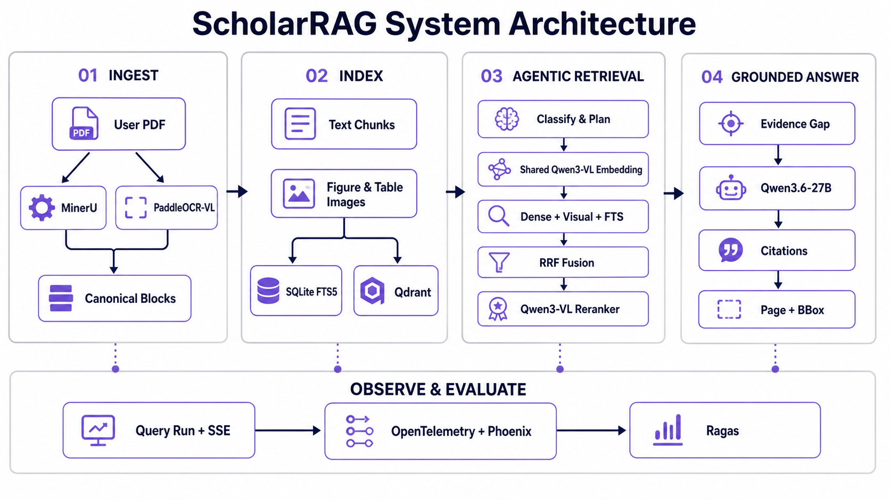

# ScholarRAG

[](https://www.python.org/)
[](https://fastapi.tiangolo.com/)
[](https://nextjs.org/)
[](https://docs.ragas.io/)
[](LICENSE)

> Traceable multimodal Agentic RAG for reading, comparing, and evaluating academic papers.

面向个人 CS / AI 论文库的可追溯、多模态 Agentic RAG Web 应用。ScholarRAG 从用户上传的 PDF 出发，完成高保真解析、文本与视觉混合检索、多步 Agent 问答、页级引用定位、实时执行追踪和自动 RAG 评测。

> [!IMPORTANT]
> 项目目前处于研究与个人使用阶段。MinerU、PaddleOCR 与硅基流动调用可能产生 API 费用。自动解析分数和 synthetic QA 不等同于人工 Gold；正式质量结论仍需真人盲标与独立复核。

## 目录

- [为什么是 ScholarRAG？](#为什么是-scholarrag)
- [核心能力](#核心能力)
- [系统架构](#系统架构)
- [技术栈](#技术栈)
- [快速开始](#快速开始)
- [基本使用](#基本使用)
- [配置重点](#配置重点)
- [Artifact 与溯源](#artifact-与溯源)
- [项目结构](#项目结构)
- [验证](#验证)
- [已验证的规模](#已验证的规模)
- [隐私与安全](#隐私与安全)
- [贡献](#贡献)
- [当前边界与路线](#当前边界与路线)
- [常见问题](#常见问题)
- [License](#license)

## 为什么是 ScholarRAG？

普通的“PDF + Chat”应用往往只保留抽取文本，难以回答以下问题：

- 双栏论文、公式、表格和图片是否在解析时丢失或错序？
- 某个结论来自哪篇论文、哪一页、哪个 block 和 bbox？
- Dense、FTS、Visual、RRF 与 Reranker 分别返回了什么？
- Agent 为什么拆出这些子问题，又为什么停止检索？
- 一次回答的质量、延迟和失败可以如何复现与评估？

ScholarRAG 将解析版本、检索候选、Agent 步骤、模型调用、引用证据和 Ragas 指标保存在同一条可恢复链路中。

## 核心能力

- **双解析与质量路由**：MinerU API 为主解析器，PaddleOCR-VL-1.6 用于质量回退和候选对照；历史 parse 不被覆盖。
- **近乎无损的论文模型**：分层保留原始 PDF、供应商 raw artifacts、Markdown、图片、canonical pages/blocks、chunks、质量报告与路由记录。
- **统一多模态空间**：Query、文本块和图片统一使用 `Qwen/Qwen3-VL-Embedding-8B` 的 1024 维向量。
- **混合检索**：SQLite FTS5、Qdrant Text Dense 与 Visual Dense 并行召回，经 RRF 融合和 `Qwen/Qwen3-VL-Reranker-8B` 多模态精排。
- **受控 Agentic RAG**：问题分类、Planner、子问题迭代、证据缺口检查、停止原因和简单问题降级均可审计。
- **工具调用型 Agentic RAG**：检索原语（`list_papers` / `get_paper` / `retrieve` / `read_chunk`）封装为 OpenAI 兼容工具，模型自主决策搜索顺序；思考过程与每次工具调用的参数、结果均流式输出到前端并可折叠查看；超时或失败自动降级到受控 RAG。Web 提供三档回答模式：工具 Agent（默认）、多步规划、单轮检索。
- **多轮会话**：同一会话内的追问自动携带父轮问题与回答上下文（`conversation_id` / `parent_run_id`），Chat Dock 以问答线程呈现历史轮次的回答、引用与 Claim 审计；恢复历史轨迹会接管其会话。
- **细粒度引用**：回答中的 `[C#]` 可定位到 claim、evidence span、chunk/block、页码和 bbox，并跳回原 PDF 页面。
- **实时执行轨迹**：异步 Query Run、追加式事件日志、SSE、断线重连、取消、终态对账和历史恢复。
- **自动评测**：Ragas 0.4、检索/排序指标、引用完整性指标，以及独立的持久化 Judge 任务。
- **视觉证据闭环**：OCR 负责定位与引用，VLM 在生成阶段直接读取图/表块图片（含 bbox 渲染兜底与质量路由门控），弥补公式、表格、复杂图表的文本损失；检索命中的图/表图片不设数量上限，全部附带以保证回答质量。
- **可观测与可部署**：质量/时延/费用看板、Docker Compose、备份校验和容量基准。
- **可选 Langfuse**：问答 Trace、阶段与工具 Span、流式模型用量和会话归组；默认关闭导出与正文采集，接入步骤见 [Langfuse 学习指南](docs/LANGFUSE.md)。

## 系统架构



## 技术栈

| 层级 | 技术 |
| --- | --- |
| Web | Next.js 16、React 19、TypeScript 5.9、React Markdown、KaTeX |
| API / CLI | FastAPI、Pydantic v2、Uvicorn、Typer、httpx、Tenacity |
| PDF | MinerU API、PaddleOCR-VL-1.6 API、PyMuPDF、pypdf |
| Embedding | `Qwen/Qwen3-VL-Embedding-8B`，1024 dimensions |
| Retrieval | SQLite FTS5、Qdrant、RRF、parent-child expansion |
| Rerank | `Qwen/Qwen3-VL-Reranker-8B`，文本 + caption + 原始图片对象 |
| Generation / Judge | `Qwen/Qwen3.6-27B`，thinking enabled |
| Evaluation | Ragas 0.4 + retrieval/citation metrics + EasyDataset adapter |
| Observability | Append-only Query Run、SSE |
| Deployment | Docker multi-stage images、Docker Compose |

## 快速开始

### 1. 环境要求

- Python 3.11～3.13（推荐通过 [uv](https://docs.astral.sh/uv/) 管理）
- Node.js 22+
- Docker / Docker Compose（运行完整服务栈时需要）
- MinerU、PaddleOCR 与硅基流动 API 凭据

### 2. 获取代码并配置环境

```bash
git clone https://github.com/LunarCache/ScholarRAG.git
cd ScholarRAG
cp .env.example .env
```

至少填写：

```dotenv
MINERU_API_TOKEN=...
PADDLEOCR_ACCESS_TOKEN=...
SILICONFLOW_API_KEY=...
```

完整配置及默认模型见 [`.env.example`](.env.example)。不要将 `.env`、真实论文或运行 artifacts 提交到仓库。

### 3. 本地开发模式

安装后端、开发、评测和 Paddle 适配依赖：

```bash
uv sync --extra dev --extra eval --extra paddle
```

安装 Web 依赖：

```bash
cd web
npm ci
cd ..
```

启动 API：

```bash
uv run uvicorn scholarrag.api.main:app --reload --host 127.0.0.1 --port 8000
```

工作空间模式需要分别启动问答、摄取和评测 Worker。先在 `.env` 设置 `SCHOLARRAG_AUTH_MODE=session` 与 `SCHOLARRAG_QDRANT_URL=http://localhost:6333`，启动 Qdrant：

```bash
docker compose up -d qdrant
```

另开终端，在同一仓库、使用相同 `.env` 和数据目录启动 Worker：

```bash
uv run scholarrag worker
```

再开一个终端启动摄取 Worker：

```bash
uv run scholarrag worker --kind ingestion
```

使用评测功能时，再启动评测 Worker：

```bash
uv run scholarrag worker --kind evaluation
```

未启动对应 Worker 时，工作空间问答或上传保持排队；API 重启不会改写正在执行的工作空间任务。三类队列各自按空间、用户轮转领取，调度顺序跨进程持久化；详见 [A24](docs/implementation/A24_FAIR_WORKSPACE_SCHEDULING.md)。所有 Worker 使用相同 `.env`、数据目录和 Qdrant 服务。评测入口位于已完成的问答下方；默认 `local` 阅读/问答仍由 API 执行。

开发结构已更新，不迁移旧摄取任务。旧开发库缺少租约/检查点字段时会明确拒绝启动，请使用新的 `SCHOLARRAG_DATA_DIR`；旧数据不会被自动删除。详情见 [A22](docs/implementation/A22_DURABLE_INGESTION_WORKER.md)。

另开终端启动 Web：

```bash
cd web
npm run dev
```

访问：

- Web：<http://localhost:3000>
- 工作空间登录与上传：<http://localhost:3000/workspace>（API 需启用 session 模式）
- OpenAPI：<http://localhost:8000/docs>

### 4. Docker Compose

填写 `.env` 并设置 `SCHOLARRAG_AUTH_MODE=session` 后，可启动 Web、API、独立问答/摄取/评测 Worker 和 Qdrant：

```bash
docker compose up --build
```

默认端口：

| Service | URL |
| --- | --- |
| Web | <http://localhost:3000> |
| API | <http://localhost:8000> |
| Qdrant | <http://localhost:6333> |

停止服务：

```bash
docker compose down
```

## 基本使用

### 上传论文

上传已统一迁移到工作空间队列。先配置 `SCHOLARRAG_AUTH_MODE=session` 并启动 API，通过 `scholarrag auth` 创建用户、工作空间和会话；在调用 CLI 的终端设置 `SCHOLARRAG_SESSION_TOKEN`，再提交：

```bash
uv run scholarrag ingest /path/to/paper.pdf --workspace ws_REPLACE
```

命令返回排队任务；`--idempotency-key` 用于安全重试同一上传。摄取 Worker 通过租约领取，并持久化 MinerU 批次 ID、PaddleOCR 作业 ID、解析候选和索引阶段；恢复使用已有供应商任务，不确定的提交或 embedding 不自动重放。激活文献与私有授权在同一事务发布，详见 [A22](docs/implementation/A22_DURABLE_INGESTION_WORKER.md)。浏览器已接通[工作空间登录](docs/implementation/A16_BROWSER_SESSION.md)和[统一上传](docs/implementation/A17_BROWSER_INGESTION.md)，访问 `http://localhost:3000/workspace` 使用管理员签发的会话令牌。

真实 PDF 默认放在本地 `paper/`，该目录不会被 Git 跟踪。说明见 [`paper/README.md`](paper/README.md)。

### 工作空间浏览器流程

API 配置 `SCHOLARRAG_AUTH_MODE=session` 后，首页自动进入工作空间登录；使用管理员签发的会话令牌，完成论文上传、范围选择、单轮/多轮问答、历史恢复、认证 SSE、引用 PDF 与报告下载，以及私有阅读状态、笔记、标签、收藏和集合。浏览器功能页切换保留草稿，切换工作空间会清理旧空间数据。

实现与限制见[问答流程](docs/implementation/A18_WORKSPACE_BROWSER_RESEARCH.md)、[阅读与集合](docs/implementation/A19_WORKSPACE_BROWSER_LIBRARY.md)。已完成一次两页 PDF 与两轮问答的[真实供应商小规模验收](docs/implementation/A20_LIVE_ACCEPTANCE.md)，不等于生产验收或检索质量 Gold。

### 检查配置

```bash
uv run scholarrag check-config
```

该命令只显示集成是否配置，不输出密钥。

### 执行问答

```bash
uv run scholarrag ask "比较这些论文的方法与实验结论" \
  -d <document-id-1> \
  -d <document-id-2>
```

Web 提问使用异步 Query Run：

```text
POST /api/workspaces/{workspace_id}/query-runs
GET  /api/workspaces/{workspace_id}/query-runs/{run_id}
GET  /api/workspaces/{workspace_id}/query-runs/{run_id}/events
GET  /api/workspaces/{workspace_id}/query-runs/{run_id}/event-log
POST /api/workspaces/{workspace_id}/query-runs/{run_id}/cancel
```

问答快照和事件写入 SQLite 的 `query_run_snapshots` / `query_run_events`，终态快照与 terminal event 在同一事务提交。SSE 从数据库按 seq 轮询，支持跨进程写入和断线续传。工作空间问答由独立 Worker 通过租约领取；排队任务可继续执行，已保存答案检查点可恢复持久化，无检查点的中断执行不会自动重放模型请求。详见 [A21](docs/implementation/A21_DURABLE_QUERY_WORKER.md)。

Web composer 提供三档回答模式（默认「工具 Agent」）：

| 模式 | 请求体 | 行为 |
| --- | --- | --- |
| 工具 Agent | `agentic=true, tool_mode=true` | 模型自主调用检索工具，思考与工具调用流式可审计 |
| 多步规划 | `agentic=true, tool_mode=false` | 受控 Planner 拆解子问题并迭代检索 |
| 单轮检索 | `agentic=false` | 一次混合检索直接生成，最快 |

同一会话（`conversation_id`）内的追问会携带 `parent_run_id`，后端将父轮问题与回答（截断 4000 字符）并入当前问题，并记录 `conversation.context` 事件以便审计。

### 运行 Ragas

工作空间中可对自己已完成的问答点击“开始评测”，填写可选参考答案；运行、停止、轨迹和结果恢复均使用私有工作空间 API。创建请求带幂等键，响应丢失后重试不重复创建任务。用户提供的参考答案标记为 candidate，不自动成为人工 Gold。

评测由独立 Worker 执行，逐指标保存检查点；已完成指标可复用，结果不确定的中断指标不自动重放。Judge HTTP 请求共用进程内 Provider 容量并持续检查授权/租约，最终结果与终态事件同事务发布。配置与验证边界见 [A23](docs/implementation/A23_WORKSPACE_EVALUATIONS.md)。

本地单用户模式的 CLI 仍支持 JSON 或 JSONL 数据集：

```bash
uv run scholarrag evaluate evals/your-dataset.jsonl
```

无参考答案时运行 citation coverage、faithfulness 和 answer relevancy；有参考答案时增加 context precision、context recall 和 factual correctness。项目还计算 recall@k、MRR、nDCG、citation validity、claim citation completeness 和 evidence span rate。

评测数据默认保存在本地且不提交，格式与生成方式见 [`evals/README.md`](evals/README.md)。

## 配置重点

| 变量 | 默认值 / 说明 |
| --- | --- |
| `SCHOLARRAG_DATA_DIR` | `./data`，运行数据与 artifacts |
| `SCHOLARRAG_EVALS_DIR` | `./evals`，本地评测集 |
| `SCHOLARRAG_MINERU_MODEL` | `vlm` |
| `SCHOLARRAG_PADDLE_MODEL` | `PaddleOCR-VL-1.6` |
| `SCHOLARRAG_PARSE_QUALITY_MODE` | `audit`；可改为 `enforce` |
| `SCHOLARRAG_PARSE_FALLBACK_MODE` | `on_review`；可能触发付费 Paddle 调用 |
| `SCHOLARRAG_EMBEDDING_MODEL` | `Qwen/Qwen3-VL-Embedding-8B` |
| `SCHOLARRAG_EMBEDDING_DIMENSIONS` | `1024` |
| `SCHOLARRAG_RERANK_MODEL` | `Qwen/Qwen3-VL-Reranker-8B` |
| `SCHOLARRAG_CHAT_MODEL` | `Qwen/Qwen3.6-27B` |
| `SCHOLARRAG_CHAT_INCLUDE_VISUAL_EVIDENCE` | `true`；回答阶段携带图/表图片给 VLM（成本开关） |
| `SCHOLARRAG_CHAT_VISUAL_MAX_EDGE` | `1024`；图片最长边缩放上限（128–4096） |
| `SCHOLARRAG_INGEST_VISUAL_BACKFILL` | `true`；图/表块缺图时按 bbox 从 PDF 渲染裁剪 |
| `SCHOLARRAG_RAGAS_JUDGE_MODEL` | `Qwen/Qwen3.6-27B` |
| `SCHOLARRAG_API_BEARER_TOKEN` | 可选的 API Bearer 鉴权 |
| `SCHOLARRAG_QUERY_WORKER_CONCURRENCY` | `2`，每个问答 Worker 的并行任务数 |
| `SCHOLARRAG_QUERY_WORKER_LEASE_SECONDS` | `30`，执行租约时长 |
| `SCHOLARRAG_QUERY_WORKER_POLL_SECONDS` | `0.5`，问答队列轮询间隔 |
| `SCHOLARRAG_INGESTION_WORKER_CONCURRENCY` | `1`，每个摄取 Worker 的并行任务数 |
| `SCHOLARRAG_INGESTION_WORKER_LEASE_SECONDS` | `30`，摄取执行租约时长 |
| `SCHOLARRAG_INGESTION_WORKER_POLL_SECONDS` | `0.5`，摄取队列轮询间隔 |
| `SCHOLARRAG_EVALUATION_WORKER_CONCURRENCY` | `1`，每个评测 Worker 的并行任务数 |
| `SCHOLARRAG_EVALUATION_WORKER_LEASE_SECONDS` | `30`，评测执行租约时长 |
| `SCHOLARRAG_WORKSPACE_EVALUATION_MAX_ACTIVE` | `16`，每个空间的 queued + running 评测上限 |
| `SCHOLARRAG_WORKSPACE_EVALUATION_MAX_PER_USER` | `4`，每个用户在当前空间的评测上限 |

Judge 使用 262,144 tokens 上下文、`temperature=0` 和 thinking；评测客户端不发送输出 token 上限。具体配置以 [`.env.example`](.env.example) 为准。

## Artifact 与溯源

```text
data/
├── artifacts/{document_id}/
│   ├── source/{sha256}.pdf
│   ├── routing/route_*.json
│   └── parses/{parse_id}/
│       ├── manifest.json
│       ├── raw/{provider}/
│       ├── canonical/document.json
│       ├── chunks/chunks.json
│       ├── quality/report.json
│       ├── visual/{block_id}.png   # bbox 渲染兜底的图/表证据
│       └── pages/page-0001@2x.png
├── scholarrag.db                  # 任务快照、事件、租约、取消标记和检查点
└── workspaces/{workspace_id}/evaluations/  # 私有评测结果文件
```

解析模型、参数或 normalizer 变化会生成新的 `parse_id`，不会覆盖旧 artifacts。只有 active parse 能进入 FTS、文本向量、视觉向量与回答链路。

## 项目结构

```text
ScholarRAG/
├── src/scholarrag/
│   ├── api/             # FastAPI routes、schemas 与安全
│   ├── ingestion/       # 解析、canonical、chunk、质量与路由
│   ├── providers/       # MinerU、PaddleOCR、SiliconFlow clients
│   ├── retrieval/       # FTS、Qdrant、RRF 与多模态检索
│   ├── rag/             # Agent、Query Run、回答与引用
│   ├── evaluation/      # Ragas、数据集、Judge 与人工门禁
│   ├── storage/         # Artifacts、catalog、queue 与 cache
│   └── benchmark/       # Parser 与容量基准
├── web/                 # Next.js Cockpit
├── tests/               # Python tests
├── docs/                # 公开协议、操作手册与架构图片
├── paper/               # 本地 PDF，占位说明被提交
├── evals/               # 本地评测集，占位说明被提交
├── docker-compose.yml
├── pyproject.toml
└── uv.lock
```

## 验证

后端：

```bash
uv run ruff check src tests
uv run ruff format --check src tests
uv run pytest -q
```

Web：

```bash
cd web
npm run lint
npm run build
npm audit --omit=dev
```

Docker：

```bash
docker compose config
docker compose build
```

## 已验证的规模

项目已完成以下本地工程验证：

| 项目 | 结果 |
| --- | ---: |
| 真实论文库 | 7 papers / 167 pages / 815 retrievable chunks |
| Active parser | 6 MinerU / 1 PaddleOCR-VL |
| 隔离容量基准 | 3,000 papers / 9,000 chunks |
| SQLite FTS P50 / P95 | 10.359 ms / 10.768 ms |
| Qdrant synthetic query P50 / P95 | 1.352 ms / 1.599 ms |
| 备份恢复 | 3,000 papers，SQLite integrity passed |

这些数据证明工程容量和恢复能力，不代表外部 API 吞吐，也不代表经过人工 Gold 校准的 RAG 准确率。

## 文档

- [优化实施记录与进度](docs/implementation/README.md)
- [MinerU 4.x 与当前云端 API 兼容性](docs/implementation/A11_MINERU_4_COMPATIBILITY.md)
- [Langfuse 接入与学习指南](docs/LANGFUSE.md)
- [多用户演进与生产化实施方向](docs/PRODUCTION_ROADMAP.md)
- [MinerU / PaddleOCR 对比协议](docs/PARSER_BENCHMARK.md)
- [人工 Gold 与 Judge 校准手册](docs/HUMAN_ACCEPTANCE.md)

## 隐私与安全

- 多用户基础采用显式开启的 `SCHOLARRAG_AUTH_MODE=session`，已开放工作空间、授权论文读取、私有问答/SSE、[个人阅读状态](docs/implementation/A12_PRIVATE_READING_STATE.md)、[私有集合](docs/implementation/A13_PRIVATE_COLLECTIONS.md)与[统一上传队列](docs/implementation/A14_UNIFIED_INGESTION_QUEUE.md) API；旧个人接口关闭，旧上传/任务接口已移除；浏览器会话令牌登录与上传已接通，OIDC 待接入。试用与限制见[身份基础](docs/implementation/A07_IDENTITY_WORKSPACES.md)、[工作空间 API](docs/implementation/A08_WORKSPACE_API.md)和[私有问答](docs/implementation/A09_PRIVATE_WORKSPACE_RUNS.md)。默认 `local` 仅保留本地阅读与问答，新增上传需使用工作空间模式。
- `.env`、真实 PDF、解析 artifacts、索引、评测集和浏览器记录已在 `.gitignore` 中排除；
- 不要上传含有未授权内容、个人数据或商业秘密的论文；
- 对外暴露 API 时请配置 `SCHOLARRAG_API_BEARER_TOKEN`、反向代理 TLS 和网络访问控制；
- 开启 `on_review` / `on_fallback`、重建 embedding 或运行 Ragas 前，请确认外部 API 成本与数据处理条款。

如果发现安全问题，请不要在公开 Issue 中粘贴 API key、论文内容或运行 artifacts。

## 贡献

欢迎通过 Issue 和 Pull Request 讨论解析协议、检索策略、评测方法与前端体验。提交前请：

1. 不包含密钥、真实论文或生成 artifacts；
2. 为行为变更添加或更新测试；
3. 运行 Python 与 Web 验证命令；
4. 在 PR 中说明 API 成本、数据迁移和兼容性影响。

工作空间还提供[解析版本审核](docs/implementation/A25_WORKSPACE_PARSE_REVIEW.md)：查看质量、追踪审核人，由 Owner/Admin 切换已注册版本；未注册候选暂不支持激活。

## 当前边界与路线

- 当前为开发中的多用户工作空间应用，已有令牌登录、授权查询、个人阅读管理与独立问答/摄取/评测 Worker；供应商、索引与评测指标检查点支持保守恢复；
- 已完成与未完成项以[实施记录](docs/implementation/README.md)为准，整体生产化计划尚未完成；
- Parser Gold、QA reviewed set 和 Judge-human correlation 仍需真实人员完成；
- PP-StructureV3 目前只用于对照，不在生产主链；
- 视觉证据的消融评测（文本 vs 文本+图）需要积累真实 query runs 后产出结论；
- 后续重点是 OIDC、候选解析准备、供应商容量与速率控制、索引批次级检查点、OIDC、PostgreSQL、对象存储和恢复演练。

## 常见问题

<details>
<summary><strong>为什么仓库中没有示例论文和运行数据？</strong></summary>

论文可能受版权限制，解析 artifacts、索引、问答轨迹和评测集也可能包含原文或私有数据，因此 `.gitignore` 默认排除 PDF、`data/`、`output/`、本地 `evals/` 和备份。请使用自己有权处理的论文进行测试。

</details>

<details>
<summary><strong>可以不用 PaddleOCR 吗？</strong></summary>

可以。将 `SCHOLARRAG_PARSE_FALLBACK_MODE=off` 可避免自动调用 PaddleOCR；也可以只在明确 fallback 时使用 `on_fallback`。关闭后仍可使用 MinerU 主解析链路。

</details>

<details>
<summary><strong>可以替换硅基流动或 Qwen 模型吗？</strong></summary>

Provider 集中封装在 `src/scholarrag/providers/`，模型名通过环境变量配置。替换 embedding 时必须同步处理向量维度、collection 版本和重建索引；替换生成或 Judge 模型时应重新运行回归评测并记录 prompt/config 变化。

</details>

<details>
<summary><strong>为什么自动评测结果不能直接称为 Gold？</strong></summary>

LLM Judge 和 synthetic QA 都可能带有模型偏好与覆盖偏差。项目要求 Parser、QA 和 Judge 分别经过真人盲标、独立复核与相关性校准，只有通过这些门禁后才会标记为 reviewed/Gold。

</details>

## License

本项目基于 [MIT License](LICENSE) 开源。
