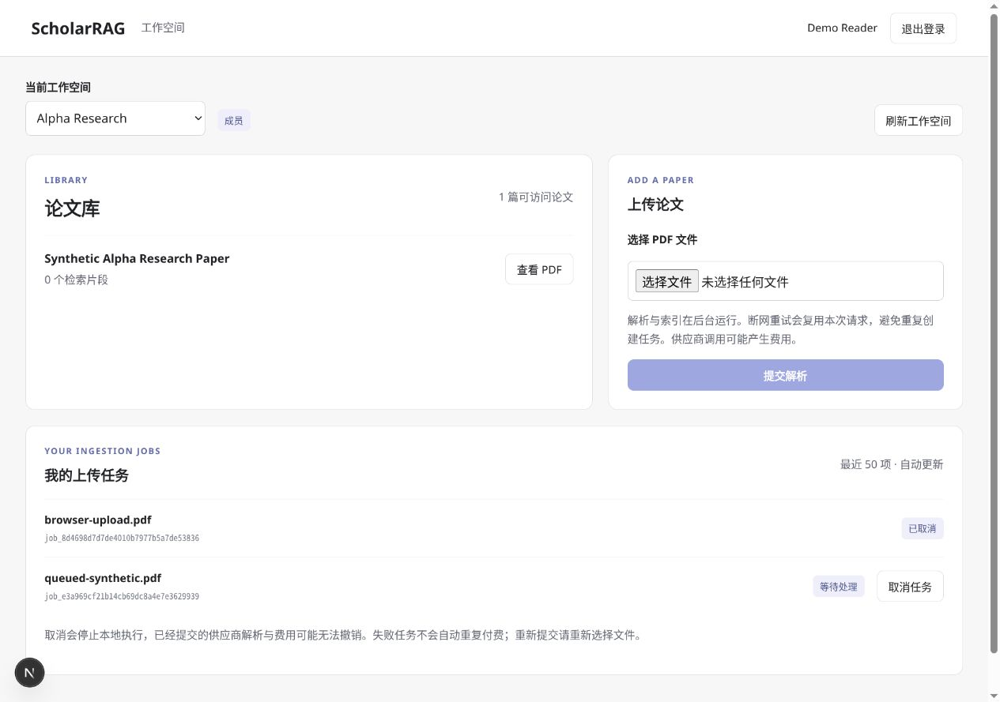

# A17：工作空间上传、私有任务与认证 PDF

实施日期：2026-10-26。状态：浏览器→工作空间上传 API→统一队列已接通；供应商执行链沿用 A14–A15，不重复建设第二套队列。

## 用户流程

1. 在 `/workspace` 使用现有会话令牌登录，选择有权限的工作空间。
2. Member / Admin / Owner 选择 PDF，提交后显示私有任务；Viewer 显示只读说明。
3. queued / parsing 任务提供取消按钮，展示 waiting、parsing、ready、failed、canceled 对应中文状态和固定错误提示。
4. 当前空间的授权论文出现在论文库中。查看 PDF 时携带认证头取回文件，以对象 URL 预览或下载。

页面仅展示最近 50 项私有上传任务，论文范围由服务端授权返回。没有新增共享论文授权、任务转移、后台管理员窥视或公开 URL 下载入口。

## 上传幂等与中断

选择一个文件时分配随机 Idempotency-Key，同一文件保留在当前表单时重复提交会使用同一 key。网络失败不会清除文件和 key，便于重试；成功收到响应后清空文件输入，避免再次误提交。重复请求返回已存在终态任务时，页面显示实际状态，不假称其重新进入队列。

重新选择文件、切换空间、刷新页面或重新登录会丢弃当前内存中的文件和 key。该策略不是持久化的离线上传恢复：若响应丢失，重新登录后应先查看任务列表，再决定是否用新请求提交，以免重复调用付费解析。

表单不手写 multipart Content-Type，由浏览器生成正确 boundary。字节、页数和 PDF 有效性校验仍由服务端执行，不用前端校验代替后端限制。请求超时：普通 API 30 秒、上传 300 秒、PDF 120 秒；超时仅终止客户端等待，不保证服务器尚未接受任务。

## 轮询与清理

活跃任务存在时每 2 秒更新论文与任务，空闲时每 10 秒检查；每轮等待前一轮完成，避免慢请求叠加。网络恢复后清除轮询错误。401 清除会话，403 清除空间数据并停止该作用域。

切换工作空间、刷新权限、退出和组件卸载时取消旧请求。收到响应后还会检查信号，防止旧请求把前一工作空间的数据写回新界面。已分配对象 URL 在关闭、替换预览或离开作用域时释放。已打开文档后续不再出现在授权论文列表时，下一次成功刷新会关闭其预览。

轮询不等于立即撤销已经读取的字节；用户保存的 PDF、浏览器自身的下载历史和进程内存无法由服务端远程删除。正在接收的 PDF 仍沿用 A08 文件响应在请求开始时校验的边界，本批没有实现逐字节授权流。

## PDF 安全路径

通过 `fetch` 携带 Bearer 请求 `/api/workspaces/{ws}/documents/{doc}/pdf`，响应必须是 `application/pdf` 才生成预览 Blob；HTML 等成功响应不能成为同源可执行预览。令牌不会出现在 iframe、下载 URL 或文件名中。

浏览器原生 PDF 查看器的可用性依赖浏览器，页面同时提供认证后 Blob 的“下载 PDF”。本次确认了认证取回、预览容器建立和实际下载，下载文件使用 PyMuPDF 验证为合成 PDF。未将所有浏览器的内置 PDF 视觉渲染宣称为已验收。

## 实现位置

- `web/app/workspace/page.tsx`：登录后工作空间、论文、上传、任务取消和 PDF 视图。
- `web/app/workspace/workspace.module.css`：作用域样式、桌面双栏与窄屏单栏。
- `web/lib/workspace-api.ts`：认证传输、限时请求、取消传播、统一错误和 PDF 类型限制。
- `web/tests/workspace-api.test.mjs`：Node 原生测试，无新前端测试依赖。
- `tests/browser_fixture.py`：本地一次性浏览器验收数据，暂停 Worker、假供应商配置、禁用私有 `.env`；绑定 127.0.0.1，不操作项目数据目录。

## 验收记录

自动测试：后端 **221 项**、前端 **19 项**全部通过，Ruff / 全量格式、TypeScript 与生产构建通过。前端 CI 新增 `npm test`。后端本批新增 4 项，前端首次建立 19 项客户端回归；没有调用真实付费供应商。

浏览器实际完成：

- 登录失败/成功和角色显示；Beta 只读空间无上传表单，Alpha 成员空间可上传。
- 选择磁盘上的合成 PDF、提交到实际上传 API，页面看到 queued 任务，再取消并看到 canceled。
- 两个空间切换后，原空间的论文、任务、上传表单和预览不继续显示。
- 授权 PDF 取回和下载，下载文件内容验证；刷新页面回到登录，退出后旧 token 再登录得到 401。
- 桌面双栏布局；390px 测试视口下 DOM 内容宽度与可视宽度均为 375px，无横向溢出；测试完成后恢复浏览器默认视口。

浏览器交互目前是本地验收，不是自动运行的端到端 CI。真实供应商从 queued 到 ready 的浏览器体验未做付费实测；A15 已有离线执行链串联测试。

桌面验收截图（一次性合成数据）：



[窄屏验收截图](screenshots/A17_workspace_mobile.jpg)

## 复现

API 与 Web 的测试端口需空闲。在仓库根目录运行一次性 Fixture：

```bash
.venv/bin/python tests/browser_fixture.py
```

它打印合成登录令牌和 PDF 路径，使用临时目录，Worker 不执行任何解析。另一个终端启动 Web：

```bash
cd web
npm run dev
```

访问 `http://localhost:3000/workspace`，用 Fixture 打印的测试会话完成上述操作。测试完成停止两个进程。不要把这套合成 Fixture 当作实际身份部署；实际用户使用管理员签发的会话，API 按 A14 配置启动。

自动验证：

```bash
uv run --extra dev --extra observability pytest -q
uv run --extra dev --extra observability ruff check src tests
uv run --extra dev --extra observability ruff format --check src tests
cd web
npm run lint
npm test
npm run build
```

后续 A18–A20 已将工作空间问答、历史、认证 SSE 与个人阅读状态/集合接入同一入口，并完成小规模真实供应商联调。独立 Worker、持久租约、对象存储与费用预算仍按原路线推进。
