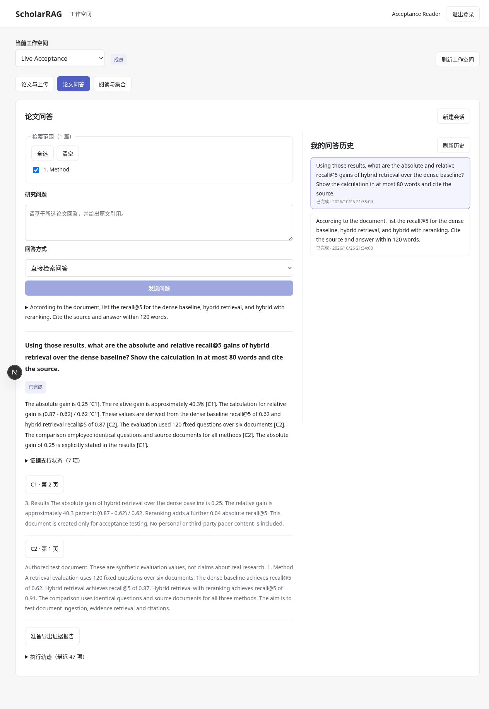

# A18：工作空间问答、认证 SSE 与历史恢复

实施日期：2026-10-26。状态：浏览器主流程已接通；真实供应商小样本验收见 [A20](A20_LIVE_ACCEPTANCE.md)。

## 用户流程

工作空间入口现在包含“论文与上传”“论文问答”“阅读与集合”三个功能页。功能页切换保留当前空间中的草稿和运行任务连接；切换工作空间、刷新权限或退出则卸载旧作用域，清理私人内容。离开工作空间只中止页面连接，不自动取消后台问答，用户可返回历史恢复或明确点击“停止回答”。

首页先读取公开健康接口中的 `auth_mode`：session 模式进入 `/workspace`，local 模式保留原本地工作台。旧工作台代码移至 `web/app/LocalWorkbench.tsx`，不丢弃原有改动。工作空间品牌链接指向 `/workspace`，避免用户误入不兼容的个人接口。健康接口仅新增运行模式，不暴露身份、凭据或工作空间列表；前后端需配套更新。

问答可选择授权论文，使用直接检索问答、工具 Agent 或多步规划。空选择不能提交，不将空范围解释为整库。运行时禁用范围修改；修改已完成问答的范围或从集合进入问答，会建立新会话。

同一范围内，完成问答后的追问发送服务端签发的 conversation ID 和 parent run ID。历史恢复重新获取受授权的 Run、事件和会话记录，显示前轮问题与答案。当前页面只显示最近 50 项历史；每个会话读取最多 100 项，尚未实现游标翻页。

## SSE 与恢复

新增 `web/lib/workspace-sse.ts`，使用 fetch + Authorization 读取事件，不将 token 放入 EventSource URL。

- UTF-8 流式解码后逐行处理，兼容跨包字符、CRLF、注释心跳和多行 data。
- 持久化 seq 作为游标；重连发送 Last-Event-ID，重复 seq 不重复追加答案。
- EOF 中未完成的帧不确认，按最后成功帧重放；非法 JSON、非法游标和过大帧停止当前连接。
- 连接最长 120 秒，断开后对同一 Run 退避重连，连续失败 5 次提示手动恢复；不通过重新 POST 问题恢复连接，不自动产生第二次付费问答。
- `access.revoked` 转为授权失败，清理当前空间数据；401 回登录，403 要求刷新权限。
- 空闲 reader 可以取消，读取响应体期间仍保留取消传播，结束时释放 reader、事件监听与定时器。

答案增量仅使用 generation.delta，原始推理 delta 不直接展示。完成后重新读取持久化结果作为最终答案。轨迹显示最近 500 项标签/状态，不渲染原始调试输入。历史恢复使用持久化日志重建增量和游标，不重新调用模型。

提交问题后若网络失败，页面明确提示先检查历史，避免盲目重复提交。后端问答 POST 尚无请求级幂等协议，因此不能声称任意断网重试都不会创建重复问答；本批保证自动 SSE 恢复不重提问题。

## 引用、导出与安全边界

引用卡展示源片段、页码和文档，点击后通过带认证头的 PDF 请求打开对应 `#page=N`。证据支持状态折叠展示，原文已定位与语义支持已验证继续分开，不将存在引用当作结论正确。

证据报告经认证接口取回，再生成页面内对象 URL 下载；Run 切换、退出和作用域卸载时释放 URL。Markdown 不启用原始 HTML，关闭回答中的远端图片渲染，避免论文或模型输出触发自动外部图片请求。

服务端仍在每次历史、事件、导出和执行阶段检查用户与工作空间授权。客户端过滤与按钮禁用只改善体验，不替代服务端权限。

## 实现与验证

实现位置：

- `web/app/workspace/WorkspaceChat.tsx`：范围、模式、多轮、历史、停止、重连、轨迹、引用与导出。
- `web/lib/workspace-api.ts`：工作空间私有接口和认证流。
- `web/lib/workspace-sse.ts`：帧解析、取消与游标。
- `web/app/page.tsx`：运行模式入口；`src/scholarrag/api/main.py`：健康模式字段。

本批新增前端 12 项回归，完整前端 **31 项通过**；包含任意分块 UTF-8、多行/CRLF、游标去重、截断重放、撤权帧、畸形数据、取消空闲流、只 GET 重连、私有状态修订、集合更新与停止正确的 Run。后端增加 2 项运行模式入口测试，完整 **223 项通过**。Ruff、全量格式、TypeScript 与生产构建通过。

真实验收：两轮问答各完成 47 个持久化事件，事件 seq 均唯一；第二轮关联第一轮的私有父 Run。浏览器点击重连后最终仍只有两个问答任务；刷新重新登录后恢复会话、回答和引用。认证报告下载内容已核对，引用 URL 确认包含正确页码。具体供应商、用量和边界见 A20。

[窄屏截图](screenshots/A18_live_mobile.jpg)。390px 测试视口下实际内容宽度与可视宽度均为 375px，没有横向溢出；验收后恢复默认视口。

## 未完成项

尚未验证生产反向代理下的 SSE 缓冲、长时间断网、多实例事件恢复和压测。工具 Agent / 多步规划入口已接通，此次真实付费问答仅选择直接检索模式；它们的服务端执行仍依赖已有离线回归。OIDC、评测和解析审核的多人界面不属于本批主流程，原有未迁移接口在 session 模式继续关闭。
