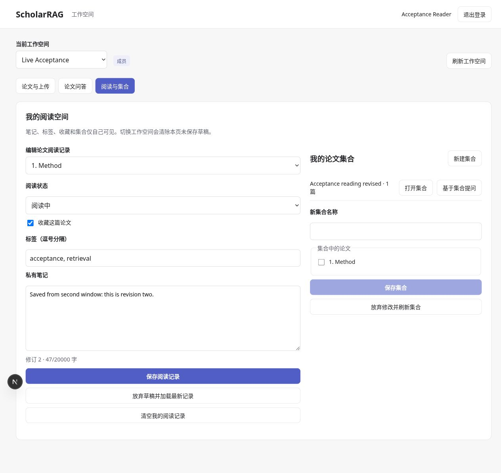

# A19：私有阅读状态、笔记与集合的浏览器流程

实施日期：2026-10-26。状态：工作空间 UI、API 串联与真实服务验收完成；数据存储沿用 A12–A13。

## 本次交付

“阅读与集合”功能页接通：

- 选择论文，读取/修改阅读状态、收藏、标签和私有笔记。
- 显式保存；刷新或重新登录后从服务端恢复。
- 创建、打开、重命名、调整成员和删除自己的集合。
- 从集合选择当前可访问论文进入问答，不自动调用模型。
- 清空个人阅读记录，保留论文；删除集合，保留论文与阅读记录。

笔记上限 20000 字符；最多 64 个标签，每个最多 64 字符；集合名称最多 120 字符，后端集合成员最多 1000 项。前端加载最多 200 个集合，完整分页仍待实现。

Viewer 可读取自身记录和集合、删除自己的已有数据，不能创建或修改；Member / Admin / Owner 可以写个人数据。同空间管理员也没有读取他人私有内容的浏览器入口。

## 并发与草稿

读取状态时保存服务端 revision，更新时提交 expected_revision。409 仅显示冲突并保留草稿，停止覆盖保存；用户必须明确放弃草稿、加载最新记录后再编辑。

笔记切换到另一篇论文时，如有未保存草稿，先显示“放弃草稿并切换”与“继续编辑”。集合有未保存修改时阻止直接切到另一集合，并提供明确的放弃/刷新操作。工作空间切换、权限撤销和退出属于作用域清理，不持久保存旧空间草稿。

集合全量 PUT 会替换成员。对于服务端返回的不可访问成员计数，保存前需要勾选确认移除这些引用；不会在用户不知情时把隐藏成员默默丢掉。当前论文权限发生变化时，保存被阻止或由服务端拒绝，要求重新加载。

保存集合的服务端响应一旦成功，立即更新当前 ID 和 revision，再刷新列表。列表刷新失败不会把已创建集合重新当作“新集合”再次 POST。删除响应成功后也先清除本地已删除编辑对象，避免后续刷新失败留下可重复操作的旧 ID。

## 作用域与安全

实现位于 `web/app/workspace/WorkspacePersonal.tsx`。接口统一经 WorkspaceApi 发往当前工作空间，并由服务端决定 user/owner。页面不保存 token 或笔记到浏览器持久存储，不允许客户端指定其他作者 ID。

切换功能页保留当前草稿；切换空间、会话失效或检测到撤权后取消在途请求并卸载编辑器。私有读取失败不回退到旧个人 API。

“清空记录”和“删除集合”均有明确的二次确认文案；集合冲突/未保存编辑状态不能直接删除旧快照。清空后的版本继续使用服务端墓碑修订号，不将 revision 重置为 0。

删除仍是应用级逻辑删除，不等同于 SQLite/WAL、备份和主机存储的安全擦除；账户级数据删除和保留策略仍待实施。

## 验收

真实浏览器操作已验证：

1. 保存阅读状态、收藏、两个标签与笔记；刷新重新登录后原值仍在。
2. 创建包含测试论文的集合并修改名称；从集合选择范围进入问答，不产生额外 Run。
3. 两个窗口同时编辑笔记：第二窗口保存 revision 2 后，第一窗口保存被 409 拒绝，草稿仍在；明确重新加载后读到 revision 2。
4. 对同一集合重复上述并发过程，保留第一窗口草稿并禁止覆盖。
5. 同空间另一个测试用户能读取共享测试论文，但自己的笔记为空、revision 0、无收藏/标签，集合列表与问答历史为空。
6. 切到另一个工作空间后原空间历史、论文、记录不继续展示。

真实 HTTP 复核也确认旧 revision 的两个 PUT 均返回 409，当前状态没有被覆盖；临时集合 DELETE 返回 204，随后读取不可用。保留主集合与笔记作为验收证据，没有为测试擦除它们。

后端完整 **223 项**、前端 **31 项**通过，类型与构建检查通过。删除传输、服务端隔离和事务失败的离线测试沿用 A12–A13；实际账单与大型文献库分页未验收。

后续：集合游标分页、共享集合的产品权限、账户删除、离线草稿恢复和独立 Worker。真实测试的范围和原始脱敏结果见 [A20](A20_LIVE_ACCEPTANCE.md)。
